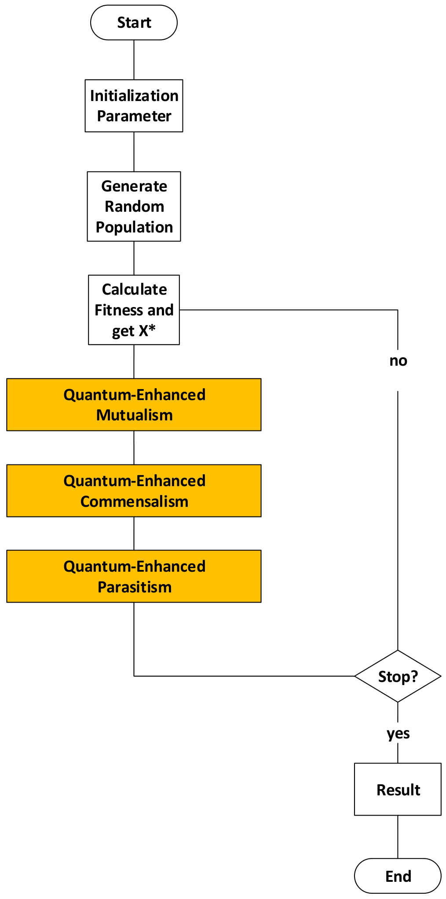

## Quantum-Enhanced Symbiotic Organisms Search (QE-SOS)

This repository provides an implementation of the **Quantum-Enhanced Symbiotic Organisms Search (QE-SOS)** algorithm, an extension of the classical **Symbiotic Organisms Search (SOS)** metaheuristic proposed in the paper:

> **Enhancing Symbiotic Organisms Search via Quantum Sampling Perturbations**  
> Authors: Giovanni Acampora, Saverio De Vito, Elena Esposito, Daniele Lizzio Bosco, **Andrea Senese**, Giuseppe Serra, and Autilia Vitiello.
> under review on Journal.

SOS is a nature-inspired optimization algorithm designed for both **continuous** and **combinatorial** optimization problems. It models the interactions among organisms within an ecosystem through three ecological relationships:

- 🤝 **Mutualism**
- 🌿 **Commensalism**
- 🦠 **Parasitism**

These interactions iteratively improve candidate solutions while naturally balancing **exploration** and **exploitation**, without relying on traditional evolutionary operators such as **crossover** and **mutation**.

QE-SOS extends the original algorithm by introducing **quantum sampling perturbations**, enabling a more effective exploration of the search space while preserving the simplicity and parameter-light nature of the original SOS framework.

  

In this work, we propose a **quantum-enhanced variant of SOS (QE-SOS)**, where probabilistic samples generated by parameterized quantum circuits are integrated into the search dynamics. These quantum-inspired perturbations are incorporated into all three interaction phases to enrich stochastic exploration while preserving the original ecological structure of the algorithm.

  

## Benchmarking

The proposed framework is evaluated on a diverse set of continuous optimization problems, including:

- Unimodal and multimodal benchmark functions  
- The Cantilever Beam Problem (CBP)

## Key Idea

Quantum-generated samples are used to introduce structured stochasticity into the evolutionary update rules, improving exploration capability while maintaining the simplicity and low-parameter nature of SOS.

