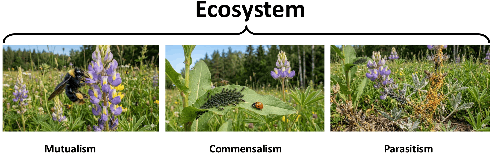

# Quantum-Inspired Probabilistic Symbiotic Organisms Search (QIP-SOS)

This repository provides the implementation of **Quantum-Inspired Probabilistic Symbiotic Organisms Search (QIP-SOS)**, a fully classical, quantum-inspired extension of the **Symbiotic Organisms Search (SOS)** metaheuristic, developed in the research paper:

> **Enhancing Symbiotic Organisms Search through Quantum-Inspired Probabilistic Sampling**  
> **Authors:** Giovanni Acampora, Saverio De Vito, Elena Esposito, Daniele Lizzio Bosco, Andrea Senese, Giuseppe Serra, and Autilia Vitiello.  
> **Status:** Manuscript under preparation.

## Overview

Symbiotic Organisms Search (SOS) is a nature-inspired population-based optimization algorithm that models ecological interactions among organisms through three successive phases:

- 🤝 **Mutualism**
- 🌿 **Commensalism**
- 🦠 **Parasitism**

These interactions iteratively improve candidate solutions by balancing exploration and exploitation, without relying on conventional evolutionary operators such as crossover and mutation.

QIP-SOS extends this framework by introducing **analytically derived, quantum-inspired probabilistic perturbations** into the commensalism and parasitism phases, while preserving classical mutualism and the original greedy selection mechanism.

  

## Proposed Approach

The proposed method is motivated by the measurement probabilities of parameterized single-qubit rotations. Rather than executing or simulating quantum circuits, QIP-SOS evaluates the corresponding probability distribution analytically:

\[
P(1\mid\theta)=\sin^2(\theta)\cos^2\left(\frac{\theta}{2}\right).
\]

This formulation enables efficient classical sampling without quantum hardware, quantum circuit simulation, or statevector representations.

The three interaction phases are implemented as follows:

- **Classical Mutualism:** Retains the original SOS update mechanism, allowing two organisms to benefit from their interaction.
- **Quantum-Inspired Commensalism:** Introduces sparse, signed perturbations based on independent Bernoulli samples, with \(P(s_d=+1)=0.25\), to modify a randomly selected subset of decision variables.
- **Quantum-Inspired Parasitism:** Employs position-dependent angle encoding and analytical probability sampling to generate signed perturbations for selected parasite coordinates.

The resulting algorithm preserves the ecosystem-based optimization structure while replacing circuit-based sampling with lightweight analytical computations.

  

## Benchmarking

The proposed framework is evaluated through experiments involving:

- **Continuous optimization benchmarks:** Unimodal and multimodal functions with different dimensionalities and landscape characteristics.
- **Engineering optimization:** The Cantilever Beam Problem (CBP).
- **Comparative evaluation:** Classical SOS, alternative perturbation strategies, and evolutionary optimization baselines.
- **Ablation studies:** Investigation of the individual contributions of quantum-inspired commensalism and parasitism.
- **Statistical analysis:** Assessment of optimization performance across independent runs.
- **Computational efficiency:** Runtime comparisons and scalability analysis.
- **Sensitivity analysis:** Evaluation of the effects of relevant sampling and perturbation parameters.

## Key Idea

The central idea behind QIP-SOS is that **measurement-inspired probability distributions can be exploited as classical stochastic search operators without executing quantum circuits**.

By combining fixed-probability perturbations in commensalism with position-dependent analytical sampling in parasitism, QIP-SOS investigates how asymmetric probabilistic search mechanisms influence optimization performance.

Unlike its earlier circuit-based formulation, QIP-SOS does not claim quantum computational acceleration or quantum advantage. Its contribution lies in the design and evaluation of efficient, analytically defined, quantum-inspired perturbation operators within the SOS framework.
